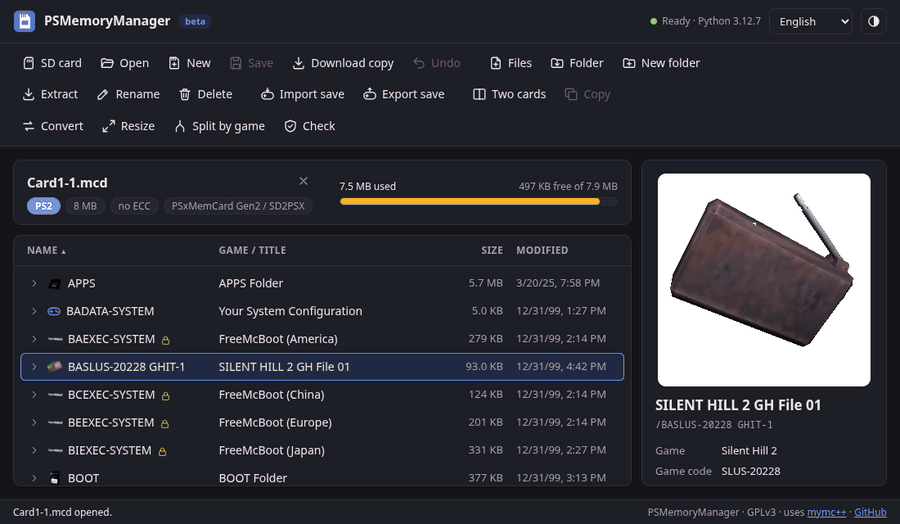
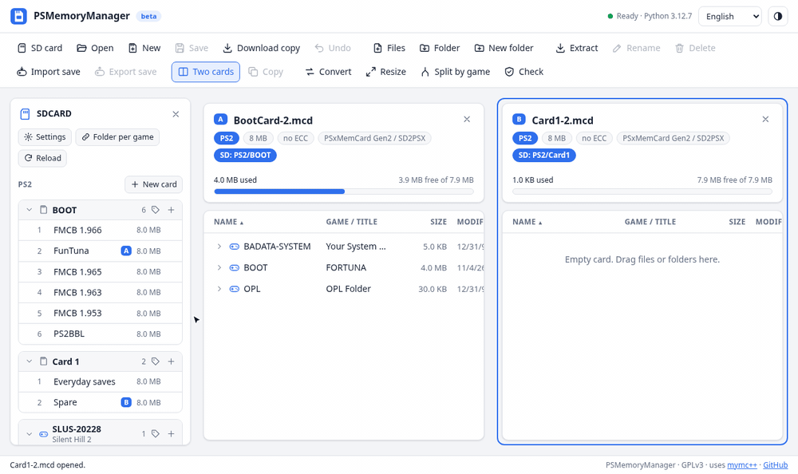
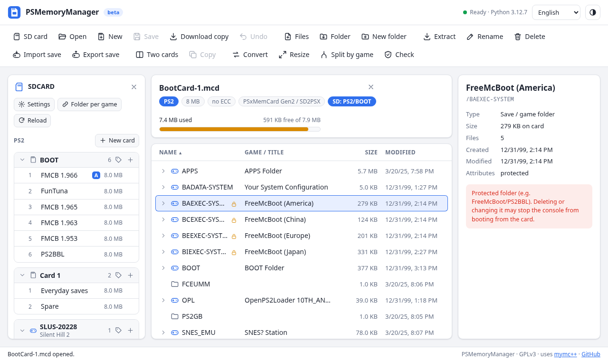
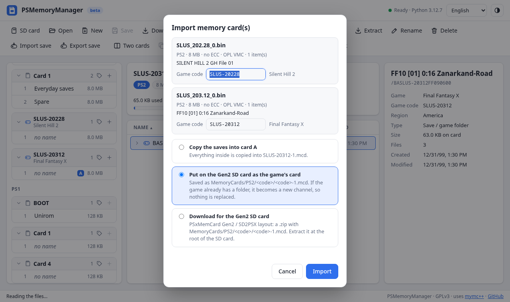
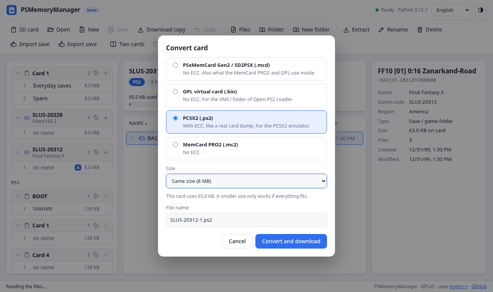
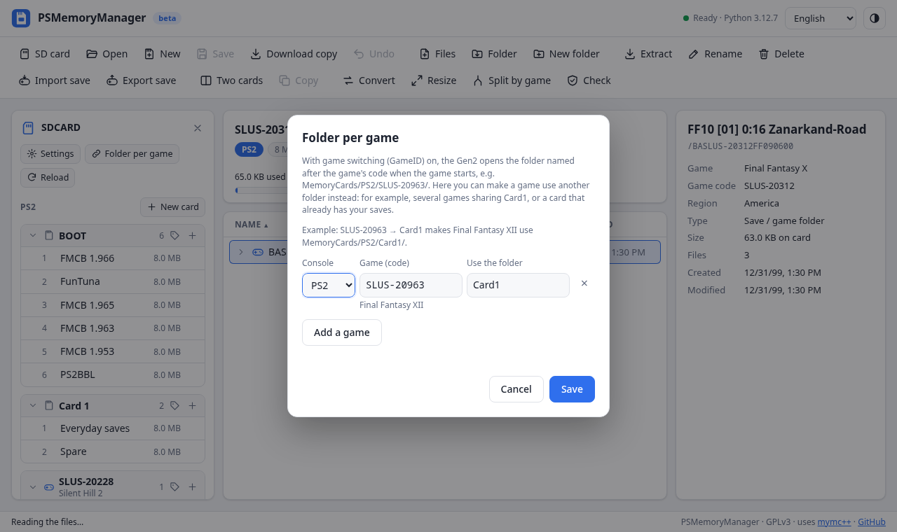
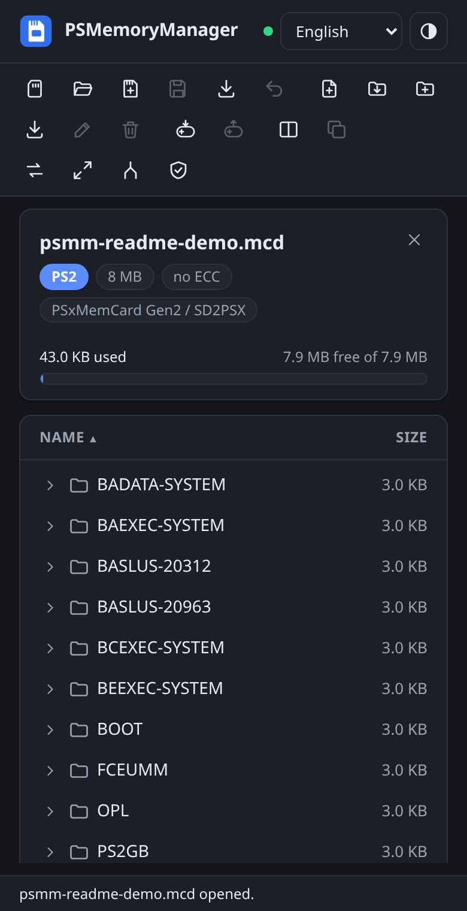

# PSMemoryManager

[English](README.md) · [Português (Brasil)](README.pt-BR.md)

A **PlayStation 2 and PlayStation 1 memory card manager that runs in your browser**. Open a card, see what is taking up space, move saves between cards, back them up, or organize the cards on a PSxMemCard Gen2 / SD2PSX SD card.

**[Open PSMemoryManager](https://gabrieltsants.github.io/PSMemoryManager/)** — nothing to install.

Prefer a program on your computer? **[Download the local app](https://github.com/gabrieltsants/PSMemoryManager/releases/latest)** (Linux; Windows coming soon): the same PSMemoryManager in a single file, nothing to install and no internet needed.

> Your files never leave your computer: everything is processed in the browser. Nothing is uploaded to a server.

> **Before editing:** back up your memory cards and the whole SD card first. PSMemoryManager is provided as-is and used at your own risk. The project and its contributors are not responsible for lost or corrupted saves, damaged cards, or other data loss or damage resulting from its use.

## What you can do

- **See what is on a card:** every save with its game name, icon, size and region, and how much space is left. PS2 saves show their 3D icons, animated like on the console. Type in the search box to find a save by name, title or game code.
- **Move saves around:** open two cards side by side and drag saves from one to the other. **Compare** shows what is only on one of them and which copy is newer, and brings the other card up to date in one click.
- **Back up and restore saves:** export saves to files and import them again, on the same card or another one.
- **Clean up:** delete saves, folders and files. Every change can be undone until you save. On PS1 cards, a deleted save can even be restored later, like on the console.
- **Resize existing cards:** make a PS2 card bigger or smaller (1 to 64 MB) without losing anything. Every save keeps its dates and attributes, and it works on cards on the SD card too.
- **Convert cards** between devices and emulators, merge cards, or split a card into one card per game.
- **Manage a PSxMemCard Gen2 / SD2PSX SD card:** see every card and channel, open and save them straight on the SD card, create new ones, name channels and change the device settings. **All saves** lists the saves of every card in one place (and shows the ones that are on more than one card), and **Backup** saves the whole SD card in one .zip file.
- **Check a card** for errors.

It works on computers and phones, in light or dark mode, in English or Portuguese (it follows your browser language; you can change it in the top bar).

  
  

  
  

## Works with

**PS2 memory cards**
- PSxMemCard Gen2 / SD2PSX
- OPL virtual memory cards (VMC)
- PCSX2
- MemCard PRO2

**PS1 memory cards**
- PSxMemCard Gen2 / SD2PSX and MemCard PRO
- DexDrive
- PSP and PS Vita (PS1 Classics)
- Emulators: DuckStation, ePSXe, Mednafen, RetroArch and others

**Save files**
- PS2: uLaunchELF/wLaunchELF (`.psu`), Action Replay MAX (`.max`), CodeBreaker, SharkPort/X-Port and PS3 (`.psv`)
- PS1: MemcardRex/PSXGameEdit (`.mcs`), PS3 (`.psv`), Action Replay/GameShark/Xploder and raw saves

Just open or drag the file: PSMemoryManager recognizes the format by itself. The full list of file types is in the [technical details](docs/formats.md).

## How to use

1. [Open PSMemoryManager](https://gabrieltsants.github.io/PSMemoryManager/) and wait for it to load (the first visit downloads about 6 MB; later visits take about a second).
2. Click **Open** and pick a memory card file, or drag it onto the page.
3. Select saves to see their details. Use the toolbar or right-click for the actions.
4. Click **Save** when you are done. Nothing changes in your file until you save.

**Using a PSxMemCard Gen2 / SD2PSX SD card:** put the SD card in your computer, click **SD card** and pick the root folder of the SD card (the one that has the `MemoryCards` folder). Click a card in the list on the left to open it; **Save** writes it straight back to the SD card.

### Local app (without internet)

1. [Download the local app](https://github.com/gabrieltsants/PSMemoryManager/releases/latest) for your computer: `linux-x86_64` for most PCs, `linux-arm64` for a Raspberry Pi or another ARM board.
2. Extract it and double-click **PSMemoryManager** (or run `./PSMemoryManager` in a terminal). Your browser opens with the app, exactly like the website.
3. When you are done, just close the browser tab: the app closes by itself shortly after.

It only runs on your computer: no other device on the network can reach it. A Windows version is coming soon.

### Good to know

- **Use Chrome or Edge** to save straight to the original file or to the SD card. Firefox and Safari work too, but they save by downloading a copy, and they open the SD card read-only.
- **Keep PS2 cards at 8 MB** unless you know you need more: larger cards are not recognized by every game, by the system menu or by FreeMcBoot.
- Folders marked with a lock are **protected** (FreeMcBoot, PS2BBL). Deleting them may stop the console from booting from the card.
- **FreePSXBoot** cards open read-only, so they keep working.
- `.vmp` (PSP/Vita) and `.psv` (PS3) files are signed when you save or export them, so the consoles accept them.

Shortcuts: `/` search · `Ctrl+O` open · `Ctrl+S` save · `Ctrl+Z` undo · `Ctrl+E` extract · `Ctrl+Shift+N` new folder · `F2` rename · `Del` delete · `Esc` clear selection.

## More

- **[Command line](docs/cli.md):** use PSMemoryManager from a terminal, step by step (Windows and Linux).
- **[Technical details](docs/formats.md):** file formats and sizes, ECC, PS1 blocks, the Gen2 SD card layout and the known limitations.
- **[Development](docs/development.md):** run it locally, tests, project layout and how the site is published.

## Credits and license

GPLv3. Uses [mymc++](https://github.com/Adubbz/mymcplusplus) by Florian Märkl and others, based on Ross Ridge's mymc (also GPLv3). PS1 support follows [MemcardRex](https://github.com/ShendoXT/memcardrex) and [vita-mcr2vmp](https://github.com/dots-tb/vita-mcr2vmp) (GPLv3). Game titles come from PCSX2's [GameIndex.yaml](https://github.com/PCSX2/pcsx2/blob/master/bin/resources/GameIndex.yaml) (GPLv3). Includes [Pyodide](https://pyodide.org) (MPL-2.0), which runs Python in the browser. Inspired by [mcd_viewer](https://github.com/gamebitfunx/mcdviewer), made for the PSxMemCard Gen2. Full credits are in the [technical details](docs/formats.md#credits).
