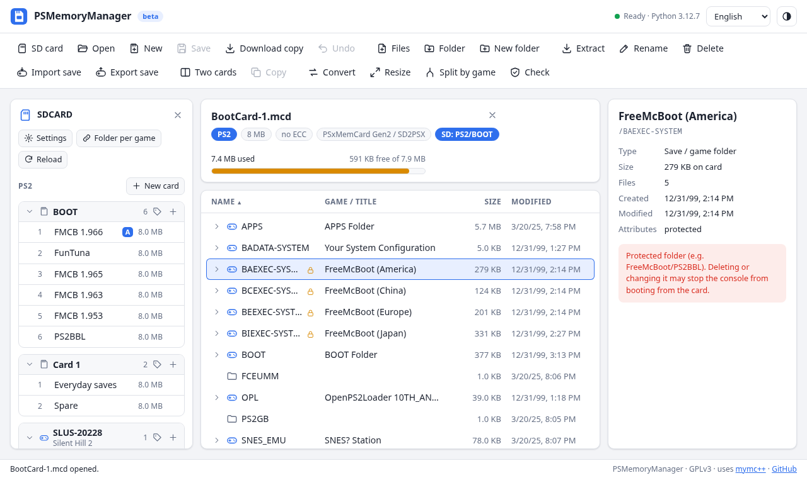
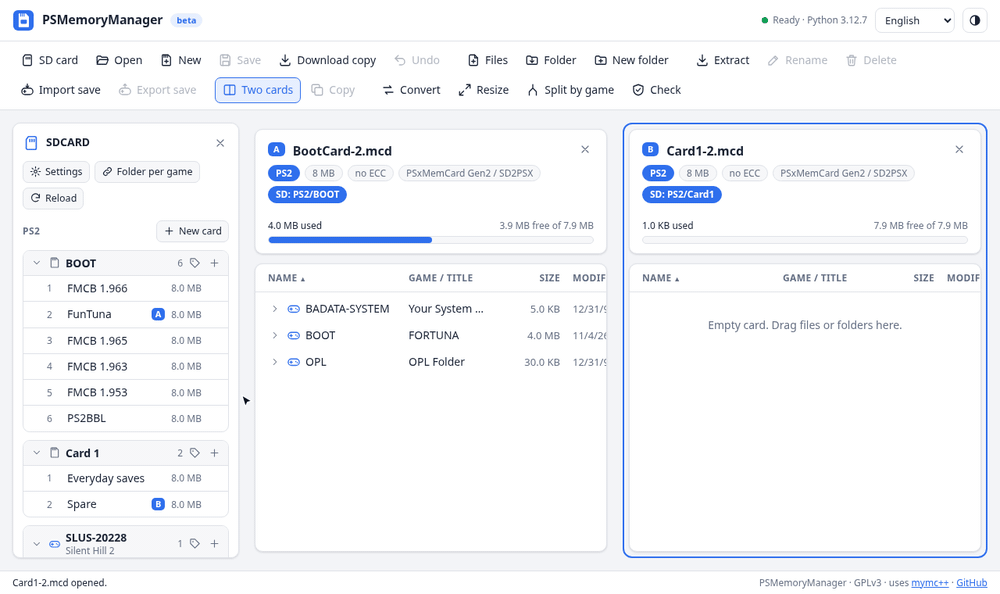
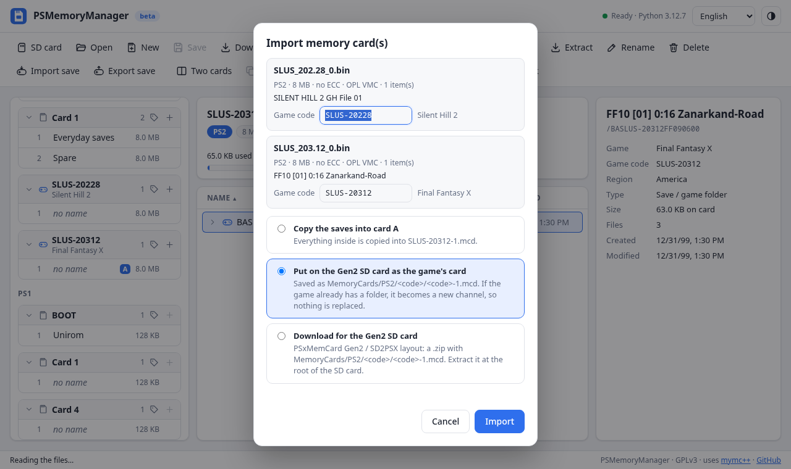
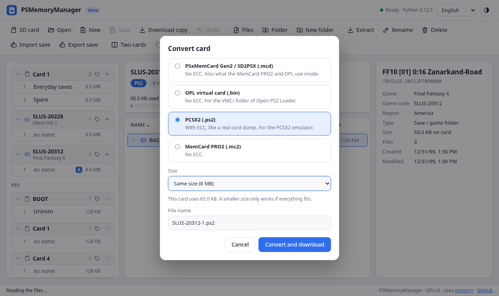
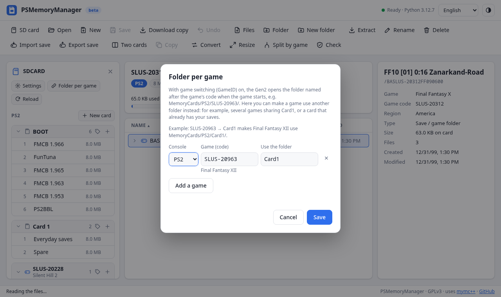
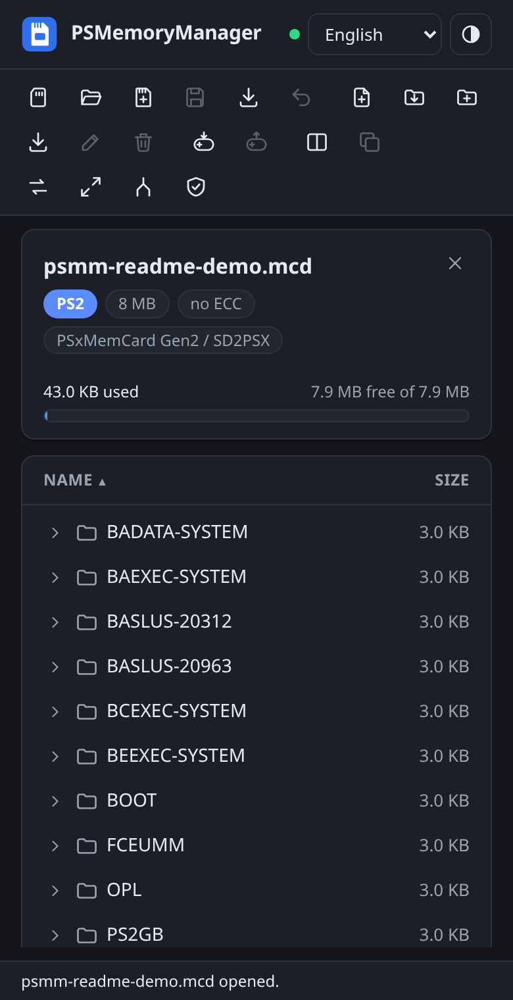

# PSMemoryManager

[English](README.md) · [Português (Brasil)](README.pt-BR.md)

Um **gerenciador de cartões de memória de PlayStation 2 que roda no navegador**. Abra um cartão, veja o que está ocupando espaço, transfira saves entre cartões ou gerencie um cartão PSxMemCard Gen2 / SD2PSX. Também funciona com VMCs do OPL, cartões do PCSX2 e MemCard PRO2.

**[Abrir o PSMemoryManager](https://gabrieltsants.github.io/PSMemoryManager/)** — sem instalação.

> Tudo é processado localmente no navegador (Python via [Pyodide](https://pyodide.org)). Nenhum arquivo é enviado a um servidor.

> **Antes de editar:** faça backup dos cartões de memória e de todo o cartão SD. Para gravar alterações diretamente em um SD Gen2, use Chrome ou Edge; Firefox e Safari só conseguem abri-lo em modo de leitura. O PSMemoryManager é fornecido como está e seu uso é por sua conta e risco. O projeto e seus colaboradores não se responsabilizam por saves perdidos ou corrompidos, cartões danificados ou qualquer outra perda ou dano decorrente do uso.



## O que ele faz

Navegue e edite cartões de memória de PS2, importe e exporte saves, converta formatos comuns de cartão e gerencie cartões e canais em um SD Gen2. Trabalhe com um cartão ou mantenha dois abertos lado a lado:



Funciona em computadores e celulares, nos temas claro e escuro. A interface está disponível em inglês e português, segue o idioma do navegador (`pt-*` usa português) e pode ser alterada na barra superior.

<p align="center">
  
  
</p>
<p align="center">
  
  
</p>

## Recursos

- Abre cartões `.mcd` (Gen2/SD2PSX), `.bin` / `.vmc` (OPL), `.ps2` (PCSX2) e `.mc2` (MemCard PRO2).
- Detecta automaticamente se a imagem contém **ECC**, usando o cabeçalho e o tamanho do arquivo.
- Exibe os saves com **nome do jogo** (lido de `icon.sys`), código do jogo, região, tamanho e datas.
- Mostra espaço usado/livre e identifica pastas protegidas (FreeMcBoot, PS2BBL).
- Adiciona arquivos e pastas pelos botões ou **arrastando-os do computador** para uma pasta.
- Extrai um arquivo individual sem alterações ou pastas e vários itens em um `.zip`.
- Cria pastas, renomeia e exclui itens, com **desfazer** (`Ctrl+Z`).
- **Saves:**
  - Importa saves `.psu`, `.max`, `.cbs`, `.sps`, `.xps` e `.psv` pelo botão ou arrastando-os para um cartão. Arquivos inválidos são listados e ignorados.
  - Exporta saves como `.psu` (recomendado: compatível com wLaunchELF, OPL e PCSX2, preserva datas e atributos) ou `.max` (Action Replay MAX). Vários saves são exportados em um `.zip`.
- **Dois cartões lado a lado:** copia saves entre cartões pelo botão "Copy" ou arrastando-os de um lado para o outro. Saves copiados para a raiz mantêm datas e atributos (incluindo a proteção do FreeMcBoot).
- **Modo cartão SD Gen2:** abre a pasta raiz do cartão SD e mostra uma lista lateral com todos os cartões e canais (PS2, PS1 e arcade), incluindo os nomes exibidos no dispositivo.
  - Clique em um canal para abri-lo. "Save" grava as alterações diretamente no SD.
  - Cria cartões (o próximo `CardN` ou uma pasta com o ID de um jogo, como `SLUS-20963`), cria canais e exclui canais.
  - Edita `settings.ini`, os nomes dos canais (`CardN.ini` / `BootCard.ini`) e `Game2Folder.ini`. Chaves desconhecidas são preservadas.
  - Para editar e gravar diretamente no cartão SD, use **Chrome ou Edge**. Firefox e Safari permitem consultar o conteúdo em modo de leitura; os arquivos dos cartões ainda podem ser baixados como cópias.
- **Cartões inteiros e conversão:**
  - "Import save" também aceita cartões inteiros (VMC `.bin` do OPL, `.mcd`, `.ps2` do PCSX2…). Você pode copiar os saves para o cartão aberto (mesclando cartões), colocá-los no SD como o cartão do jogo (`MemoryCards/PS2/SLUS-20228/SLUS-20228-1.mcd`; o código do jogo vem do nome do arquivo OPL ou dos saves; uma pasta de jogo existente recebe um novo canal) ou baixar um `.zip` organizado para o SD Gen2.
  - Converte cartões entre Gen2 `.mcd`, OPL `.bin`, PCSX2 `.ps2` (com ECC) e MemCard PRO2 `.mc2`, e também pode alterar o tamanho. Conversões do mesmo tamanho são idênticas bit a bit; ao redimensionar, tudo é preservado com datas e atributos.
  - Separa um cartão por jogo: um cartão para cada jogo, diretamente no SD Gen2, em `.zip` no formato do SD Gen2 ou em `.zip` para OPL (`VMC/SLUS_202.28_0.bin`, padrão de nomes usado pelo próprio OPL).
  - Ao converter para `.bin` do OPL, sugere o nome do arquivo do jogo (`SLUS_202.28_0.bin`).
  - Redimensiona o cartão aberto (de 1 a 64 MB). Tudo é preservado, a alteração pode ser desfeita e "Save" grava o resultado, inclusive no SD.
- **Títulos dos jogos:** pastas de jogos no SD exibem o título abaixo do código (`SLUS-20228` → *Silent Hill 2*) e um ícone; os detalhes dos saves também mostram o jogo. A lista de cerca de 12.700 jogos só é carregada quando necessário.
- Verifica a integridade do sistema de arquivos.
- Cria cartões de 1 a 64 MB, com ou sem ECC.
- Salvamento:
  - **Chrome e Edge** gravam diretamente no arquivo original, inclusive no cartão SD.
  - **Firefox e Safari** baixam uma cópia.
- Cada alteração é feita em uma cópia e verificada antes de ser aplicada.
- Temas claro e escuro; também funciona em celulares.

Atalhos: `Ctrl+O` abrir · `Ctrl+S` salvar · `Ctrl+Z` desfazer · `Ctrl+E` extrair · `Ctrl+Shift+N` nova pasta · `F2` renomear · `Del` excluir · `Esc` limpar seleção.

## Roadmap

| Fase | Escopo |
|---|---|
| 1 ✅ | Núcleo, leitura e edição seguras, página web, inglês/português |
| 2 ✅ | Importação de saves (`.psu`, `.max`, `.cbs`, `.sps`, `.xps`, `.psv`), exportação `.psu`/`.max`, dois cartões lado a lado |
| 3 ✅ | Modo SD Gen2: pasta do cartão SD com todos os cartões e canais, criação de cartões/canais, edição de `settings.ini`, nomes dos canais e `Game2Folder.ini` |
| 4 ✅ | Conversão: OPL ↔ Gen2 ↔ PCSX2 ↔ MemCard PRO2 (com/sem ECC), redimensionamento, divisão por jogo, mesclagem, VMC do OPL → pasta de jogo no SD |
| 5 | Cartões de memória de PS1 (`.mcr`, `.mcd`, `.gme`, `.vmp`, `.mcs`) |
| depois | Modelos prontos (OPL, FreeMcBoot, PS2BBL, FunTuna) para novos cartões, após a verificação das licenças |

## Formatos de PS2

| Origem | Extensão | ECC | Tamanho (8 MB) |
|---|---|---|---|
| PSxMemCard Gen2 / SD2PSX | `.mcd` | não | 8.388.608 bytes |
| OPL (VMC) | `.bin` | não | 8.388.608 bytes |
| MemCard PRO2 | `.mc2` | não | 8.388.608 bytes |
| PCSX2 | `.ps2` | sim | 8.650.752 bytes |

No Gen2, os cartões ficam em `MemoryCards/PS2/<pasta>/<pasta>-<canal>.mcd`. Exemplos: `MemoryCards/PS2/BOOT/BootCard-1.mcd` e `MemoryCards/PS2/SLUS-20963/SLUS-20963-1.mcd`.

## Linha de comando

O mesmo núcleo funciona no terminal (Linux e Windows, Python 3.10+). As mensagens seguem o idioma do sistema ou podem ser definidas com `--lang en|pt`:

```bash
pip install .
psmm Card1-1.mcd info
psmm Card1-1.mcd ls -r
psmm Card1-1.mcd extract BASLUS-20963 -o saves/
psmm Card1-1.mcd add MySave/ -d /
psmm Card1-1.mcd rm -r BASLUS-20963
psmm Card1-1.mcd check
psmm new New.mcd --size 8
psmm sd /media/SDCARD          # visão geral somente leitura de um cartão SD Gen2
psmm convert SLUS_202.28_0.bin sh2.ps2          # VMC OPL -> PCSX2 (a extensão define o formato)
psmm convert card.ps2 card.mcd --size 16        # PCSX2 -> Gen2, 16 MB
psmm split all.mcd /media/SDCARD                # um cartão por jogo, no formato do SD
psmm Card1-1.mcd merge SLUS_202.28_0.bin other.ps2   # copia tudo de outros cartões
psmm Card1-1.mcd resize 16                      # altera o tamanho (com backup)
```

No terminal, cada alteração cria primeiro um backup do cartão:

- Linux: `~/.local/share/PSMemoryManager/backups`
- Windows: `%LOCALAPPDATA%\PSMemoryManager\backups`

## Desenvolvimento

```bash
python -m venv .venv && . .venv/bin/activate
pip install -e ".[dev]"
pytest
python tools/build_site.py          # gera o site em _site/
python -m http.server -d _site 8000 # http://localhost:8000
```

Organização:

- `psmm/core/`: núcleo independente da interface (formatos, cartões, saves, estrutura do SD, arquivos INI, conversão, ECC rápido, backups e traduções).
- `psmm/web_api.py`: ponte usada pela página web.
- `psmm/cli.py`: linha de comando.
- `web/`: página (HTML/CSS/JS, sem etapa de build). O Pyodide roda em um Web Worker. Os textos da interface ficam em `web/i18n.js`.
- `tools/build_site.py`: gera o site. Também inclui um ID de build (hash do conteúdo do site) nas URLs dos arquivos (`app.js?v=<id>`) e cria `version.json`. A página verifica esse arquivo ao abrir, quando a aba volta a ficar visível e a cada 10 minutos. Após uma publicação, ela se atualiza automaticamente se nada estiver aberto ou mostra uma barra para atualizar; cartões abertos nunca são perdidos. Os arquivos-fonte usam o marcador `__BUILD__`.
- `.github/workflows/pages.yml`: executa os testes e publica o site na branch `gh-pages` (usada pelo GitHub Pages) a cada push para `main`.

Para adicionar um idioma, inclua uma coluna em `psmm/core/i18n.py` (mensagens do núcleo) e um bloco em `web/i18n.js` (interface).

## Observações

- Saves `.psv` (PS3) podem ser importados, mas não exportados; o mymc++ não implementa a gravação nesse formato.
- Cartões de PS1 no SD são listados, mas só poderão ser abertos a partir da fase 5. A criação de cartões é limitada a PS2 e arcade (COH). Cartões de Conquest do SoulCalibur II usam formato próprio.
- A exportação `.max` não preserva datas dos arquivos (o formato não comporta essa informação) e sua compressão LZARI roda em Python puro. Saves comuns costumam levar alguns segundos; pastas com vários megabytes podem levar minutos. Prefira `.psu`.

## Créditos e licença

Os títulos dos jogos vêm do [GameIndex.yaml do PCSX2](https://github.com/PCSX2/pcsx2/blob/master/bin/resources/GameIndex.yaml) (o PCSX2 é GPL-3.0; os créditos dos dados são de sonyindex, serialstation, psxdatacenter e redump). Apenas o código e o título são mantidos em `psmm/data/gamedb.json`, gerado novamente por `python tools/update_gamedb.py`.

GPLv3. Usa [mymc++](https://github.com/Adubbz/mymcplusplus), de Florian Märkl e outros, baseado no mymc de Ross Ridge (também GPLv3). Inspirado no [mcd_viewer](https://github.com/gamebitfunx/mcdviewer) e feito para o PSxMemCard Gen2.
